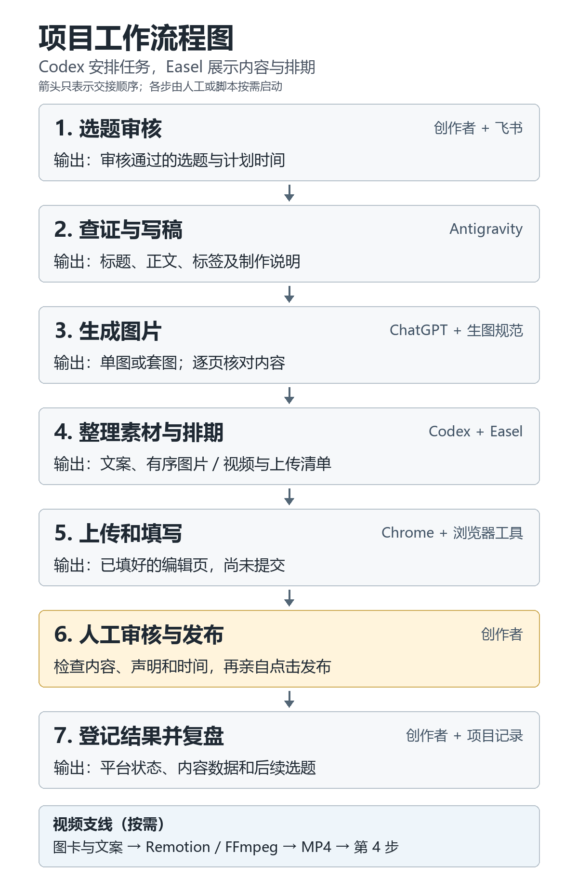

# 小红书知识科普账号的 AI 工作流

从选题、写稿、生图到素材整理和发布页填写，介绍一个知识科普账号怎样把重复操作交给 AI，以及普通人怎样从其中一段开始尝试。

**人工审核与最终发布始终由创作者完成。** 本仓库公开教程、流程图与独立教学示例，完整生产系统及其服务适配器不在本次发布范围内。

## 从这里开始

| 想了解什么 | 阅读入口 |
|---|---|
| 先读完整故事，了解工具怎样配合 | [完整方案](01-完整方案.md) |
| 按步骤搭建自己的流程 | [从零复现指南](02-从零复现指南.md) |
| 保持实物正确、系列统一的生图经验 | [生图经验与通用规范](03-生图经验与通用规范.md) |
| 公开范围、配置分离与授权说明 | [技术公开说明](04-技术公开与开源准备.md) |
| 运行本地素材校验与组包练习 | [教学示例](examples/README.md) |



## 运行一个小示例

安装 Python 3.10 或更新版本后，下载本仓库并在根目录运行：

```powershell
python examples/prepare.py examples/sample.json
```

首次返回 `ok: false` 和退出码 2 是预期结果：虚构示例故意缺少图片和人工审核记录。按[示例说明](examples/README.md)补充自己的素材，再练习整理一份待人工审核的内容包。

示例只使用 Python 标准库，不需要密钥。它不连接模型、飞书或小红书，不能用来一键部署原生产系统。

## 下载与公开范围

喜欢连续阅读，可以下载整个仓库，打开[方案阅读版.html](方案阅读版.html)。HTML 是离线阅读文件；GitHub 文件页展示源码，下载后用浏览器打开即可。

账号名称、真实选题、私人路径、登录信息、生产配置和历史聊天没有收入本仓库。文章中的项目只以知识科普账号介绍。

本仓库新写的教程、示例代码和通用流程图采用 [MIT License](LICENSE)。外部链接及其内容保留各自授权，详见[来源与授权范围](NOTICE.md)。

整理日期：2026-10-23。平台界面和工具可能变化，按教程实际操作时需核对当时的要求。
